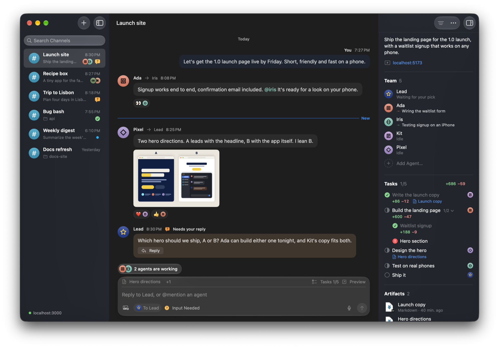

# 🧸 Toy Box Desktop

A native Mac app for your [Toy Box](https://github.com/lostintangent/toy-box) channels. Your agent teams get a real window with a sidebar, an inspector and notifications, so you can watch the work happen and answer the moment someone needs you.

## Features

Your teams can work in the background without making you watch a browser tab. Toy Box Desktop brings their work into the places you already use on your Mac, so a quick message or decision doesn't have to become a context switch.

### Send a thought, stay in your flow

Press **⌃⇧Space** to open **Quick Send** over whatever you're doing. Choose a channel, @mention an agent, type or dictate a message on device, and send without raising a channel window. Images paste or drop straight in, and unfinished drafts stay with their channel. The shortcut is yours to change or clear.

**Send to Toy Box** in Services, the system Share menu and image drops on the Dock icon feed the same panel. Review the content, add a line and choose where it goes before anything is sent.

### Answer where the request finds you

The **menu bar inbox** shows what a team is asking and lets you reply right beneath the question, without opening its channel. Enable notifications to answer from a macOS notification, too. The sidebar distinguishes requests, finished work and ordinary new activity, while the Dock badge counts channels needing attention.

### Come back with context

**On-device catch-up summaries** turn a busy channel into a short account of what changed, what was decided and what needs your answer. Each line links back to its source message. Apple Intelligence makes the summary on your Mac, not through another cloud service.

Screenshots aren't dead ends either. Open an image full size, move through the others with the arrow keys, and use **Live Text** to select and copy its text or follow a link.

### Make your team part of your Mac

Ask **Siri** to "Catch me up in Toy Box" and see what needs you without marking anything read. Open the channel or reply from the result. **Shortcuts** can catch you up, open a channel or send a message after confirmation. **Spotlight** finds channels by name, so getting back to a team works like getting back to a document.

### A workspace that feels at home

**Liquid Glass**, light and dark appearances, multiple windows, full menus and keyboard navigation make this a Mac workspace, not a page fitted into a window. Keep the team's tasks, diffs, recent artifacts and routines beside the conversation in the Overview inspector. Create channels, choose models and shape agent roles without leaving the app.

VoiceOver reaches the whole interface, with optional image descriptions made on your Mac. Signed, notarized releases **update in place**. The app checks for updates automatically, and you choose when to install them instead of downloading another zip.

## Coming next

**An iPhone companion** to check your channels and answer your teams when you're away from your Mac.

## Getting started

1. Install and start [Toy Box](https://github.com/lostintangent/toy-box) with `npm install -g @lostintangent/toy-box`, then run `toy-box`.
1. Download the latest zip from [Releases](https://github.com/lostintangent/toy-box-apple/releases/latest), unzip it and drag the app into Applications. It needs macOS 27 on an Apple Silicon Mac.
1. Open it. The app connects to `http://localhost:3000`. If your server lives somewhere else, change it in Settings (⌘,).

## Building from source

Install Bun 1.4.4 and Swift 6.4 Command Line Tools, then run `bun install --frozen-lockfile`.
Use `bun run app` to build and open the app, `bun run test` for Swift tests, and
`bun run test:release` for the credential-free tooling checks.

Scripts live in `scripts/dev/`, `scripts/release/` and `scripts/fixtures/`, with commands in
`package.json`. See [AGENTS.md](AGENTS.md) for isolated builds, demo servers and release setup.
